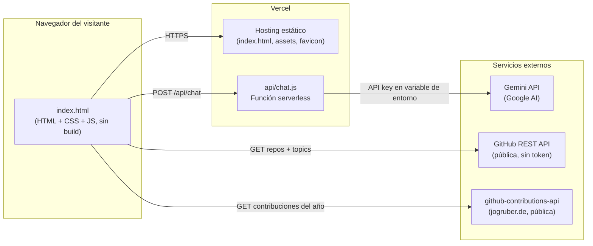
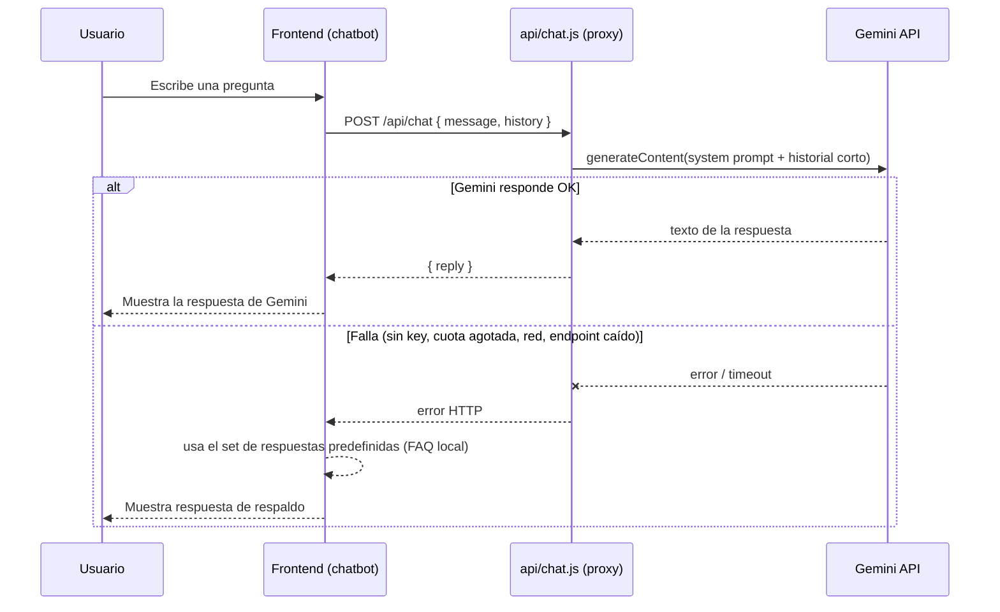
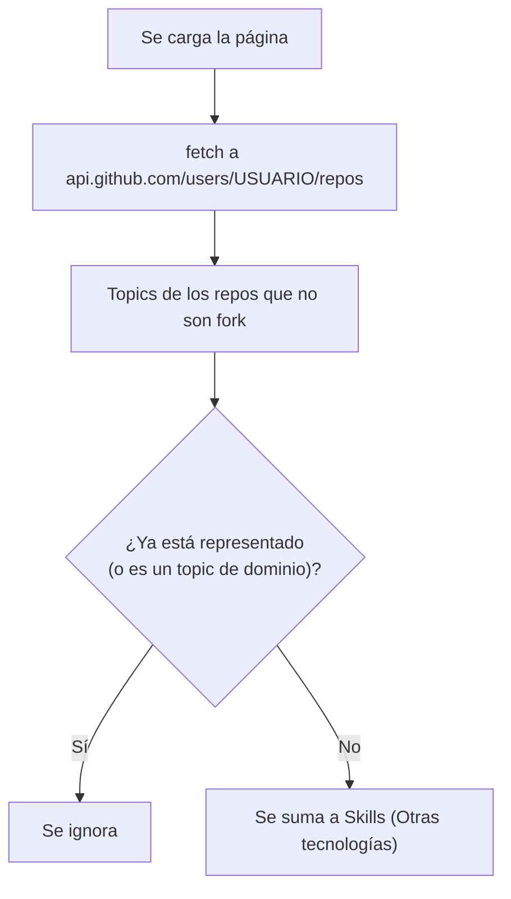

# Portfolio — Javier Fiestas


Landing page de portafolio personal de **Javier Fiestas Calixto** — Bachiller en
Ingeniería de Sistemas, Analista de Datos y Automatización. Este documento es
un reporte técnico del proyecto: cómo está construido, qué tecnologías usa,
qué conexiones/integraciones externas hace y cómo se relacionan entre sí.

**Sitio en vivo:** [javier-fiestas.vercel.app](https://javier-fiestas.vercel.app/)

<!-- Sugerencia: agregar una captura de pantalla del sitio acá, por ejemplo:
 -->

---

## Tabla de contenidos

- [Descripción del proyecto](#descripción-del-proyecto)
- [Características principales](#características-principales)
- [Arquitectura](#arquitectura)
  - [Vista general](#vista-general)
  - [Flujo del chatbot](#flujo-del-chatbot)
  - [Sincronización con GitHub](#sincronización-con-github)
- [Stack tecnológico](#stack-tecnológico)
- [Conexiones e integraciones externas](#conexiones-e-integraciones-externas)
- [Seguridad](#seguridad)
- [Estructura del proyecto](#estructura-del-proyecto)
- [Cómo ejecutarlo localmente](#cómo-ejecutarlo-localmente)
- [Roadmap](#roadmap)
- [Contacto](#contacto)

---

## Descripción del proyecto

Es un sitio de portafolio de una sola página (single-page), construido como
**HTML/CSS/JS estático puro** — sin frameworks de frontend ni proceso de
build — más **una función serverless** para las partes que necesitan un
secreto de servidor (la conexión con la IA). La idea detrás del diseño fue
que cada sección no fuera solo texto estático, sino que reflejara
directamente las habilidades técnicas del perfil: un calendario de
contribuciones armado con datos reales de GitHub, un chatbot
conectado a un modelo de lenguaje de verdad, proyectos presentados como casos
de estudio con su diagrama de arquitectura, y un CV en versión web.

## Características principales

- **Portada con escena animada**: nombre y rol fijos y, al lado, un portátil
  flotante cuya pantalla es una terminal que escribe una consulta SQL y un
  script de Python, muestra el resultado y lo convierte en gráfico; alrededor,
  tarjetas de dashboard en 3D que se inclinan con el ratón, y el robot del
  chatbot, que sigue el cursor con los ojos y abre el chat. Acento teal propio
  en todo el sitio y bandas de fondo alternas.
- **Caso de trabajo**: un dashboard interno que construí en mi último empleo
  (Node.js/Express + React + D3 sobre Zoho Analytics y Zoho CRM), contado
  como problema → solución → resultado, con su diagrama y 4 decisiones
  técnicas. Anonimizado: sin dominios, IDs, tablas ni datos de clientes.
- **Robot flotante + chatbot con IA real**: conectado a la API de Gemini a
  través de una función serverless (la API key nunca llega al navegador).
  Tiene un system prompt con el perfil profesional completo y reglas de
  estilo (respuestas breves, sin salirse de tema, sin Markdown). Si la
  llamada a Gemini falla por cualquier motivo, cae automáticamente a un set
  de respuestas predefinidas por palabra clave, así el chatbot nunca se
  queda roto.
- **Calendario de contribuciones de GitHub en vivo**: calendario propio
  (mismo tamaño/color/cantidad de cuadros que github.com) armado con datos
  reales del año en curso, con tooltips por día y celdas de ancho fluido
  que llenan el contenedor.
- **Proyectos como casos de estudio**: cuadrícula curada a mano (con
  Finanzas Gestor destacado), donde cada tarjeta lleva un diagrama de
  arquitectura en SVG inline hecho a partir del README real del repo, que
  cambia de colores con el tema y se dibuja al entrar en pantalla antes de
  mostrar el "flujo de datos" animado.
  Además lleva problema → solución, datos técnicos verificables, el stack y
  el enlace al código.
- **CV web (`cv.html`)**: el botón "Ver CV" abre el currículum como página
  (no como archivo), en español e inglés, sin teléfono ni dirección. El PDF
  descargable será el CV original de Javier (pendiente de subir).
- **Sincronización con GitHub**: los topics de los repos públicos alimentan
  la sección Skills ("Otras tecnologías").
- **Selector de idioma**: español (bandera del Perú) e inglés, sin recargar
  la página.
- **Modo claro/oscuro**, diseño responsive, colores de marca por tecnología
  en cada tag/skill, y accesibilidad básica (roles ARIA, foco de teclado,
  `prefers-reduced-motion`).

## Arquitectura

### Vista general



La idea central: el sitio es **100% estático** (se puede servir desde
cualquier CDN), y la **única pieza con backend** es `api/chat.js`, que
existe exclusivamente porque la API key de Gemini no puede exponerse en el
navegador. Todo lo demás (calendario de GitHub, sincronización de Skills)
llama directo a APIs públicas que no requieren autenticación.

### Flujo del chatbot



El historial que se manda a Gemini se recorta a los últimos mensajes (no
toda la conversación) para ahorrar tokens, y el modelo corre con
`thinkingLevel: "low"` para minimizar el razonamiento interno invisible que
consumen los modelos Gemini 3.x — ambos ajustes se calibraron con datos
reales de uso de tokens en producción.

### Sincronización con GitHub



Los proyectos, en cambio, están curados a mano: así la sección se ve completa
aunque la API de GitHub falle o llegue a su límite de peticiones.

## Stack tecnológico

| Capa | Tecnología |
|---|---|
| Estructura y estilos | HTML5, CSS3 (Grid, Flexbox, custom properties, animaciones) |
| Lógica de frontend | JavaScript vanilla (sin frameworks ni bundler) |
| Backend | Función serverless en Node.js (runtime de Vercel) |
| Hosting | Vercel (sitio estático + función serverless en el mismo despliegue) |
| IA conversacional | Google Gemini API (`gemini-3.6-flash` por defecto) |
| Tipografías | Google Fonts (Playfair Display, Plus Jakarta Sans, Caveat) |
| Iconografía | Font Awesome 6, flag-icons (banderas del selector de idioma) |
| Diagramas | SVG inline escrito a mano, con colores ligados a los tokens del tema |
| Control de versiones | Git + GitHub |

## Conexiones e integraciones externas

| Integración | Uso | Autenticación |
|---|---|---|
| **Google Gemini API** | Motor de respuestas del chatbot | API key guardada como variable de entorno en Vercel, nunca expuesta al cliente |
| **GitHub REST API** (`api.github.com`) | Topics de los repos públicos para la sección Skills | Pública, sin token (datos públicos, límite de tasa estándar de GitHub) |
| **github-contributions-api** (`github-contributions-api.jogruber.de`) | Datos del calendario de contribuciones (servicio de terceros que lee el perfil público de GitHub, ya que la API REST no expone ese calendario sin token) | Pública, sin token |
| **Vercel** | Hosting del sitio estático y de la función serverless `api/chat.js` | Variables de entorno del proyecto |

## Seguridad

- La API key de Gemini vive **exclusivamente** como variable de entorno del
  lado del servidor (`api/chat.js` corriendo en Vercel) — nunca se incluye
  en el HTML/JS que descarga el navegador, precisamente porque cualquier
  clave puesta ahí quedaría visible con solo inspeccionar el código fuente.
- `api/chat.js` valida el método HTTP, limita el tamaño de los mensajes,
  rechaza llamadas de navegadores desde otros dominios (CORS + chequeo del
  `Origin` en el servidor) y aplica un límite de peticiones por IP. Ese
  límite vive en memoria, así que es aproximado (Vercel puede repartir las
  llamadas entre varias instancias).
- La API key se envía a Gemini en una cabecera (`x-goog-api-key`), no en la
  URL, para que no quede en trazas ni mensajes de error.
- El sitio se queda en el **nivel gratuito** de Gemini a propósito: pone un
  techo natural de costo en $0 — si alguien abusa del endpoint, se topa con
  el límite de cuota gratuita en vez de generar una factura.
- Ningún secreto real vive en este repositorio ni en su historial (`.env`,
  `.env.local` y `.vercel` están en `.gitignore`; `.env.example` es solo una
  plantilla sin valores).

## Estructura del proyecto

```
index.html          Todo el frontend: HTML + CSS + JS (sin build)
cv.html             CV en versión web (ES/EN)
favicon.svg          Ícono del sitio
api/
  chat.js            Función serverless: proxy hacia la API de Gemini
.env.example          Plantilla de variables de entorno (sin valores reales)
Animation/
  Laptop/            Fotos de referencia de una laptop (sin uso en el sitio)
  Snorlax/           Sprites de una animación anterior (sin uso actual)
  U/                 Logo de la Universidad de Lima (sin uso todavía)
```

## Cómo ejecutarlo localmente

El sitio no necesita build ni servidor para las partes estáticas — alcanza
con abrir `index.html` en el navegador. Para probar el chatbot con Gemini
funcionando localmente hace falta la CLI de Vercel (para simular la función
serverless):

```bash
npm i -g vercel
vercel dev
```

Copiar `.env.example` a `.env` y completar `GEMINI_API_KEY` con una key
propia de [Google AI Studio](https://aistudio.google.com/apikey) antes de
correr `vercel dev`.

## Roadmap

- [ ] Traducir el chatbot al inglés.
- [ ] Afinar aún más el system prompt del chatbot según el uso real.
- [ ] Sumar capturas o GIFs reales de cada proyecto junto a su diagrama.
- [x] Rediseñar la portada con un visual de datos y añadir un caso de
      trabajo anonimizado (bloque 2, 2026-10-11).
- [ ] Límite de peticiones estricto para el chatbot con un almacén
      compartido (ej. Upstash Redis), en lugar del límite en memoria.

## Contacto

- **LinkedIn:** [linkedin.com/in/javier-fiestas](https://www.linkedin.com/in/javier-fiestas-6457ba240/)
- **GitHub:** [@Javier3921](https://github.com/Javier3921)
- **Correo:** javierfiestas44@gmail.com
